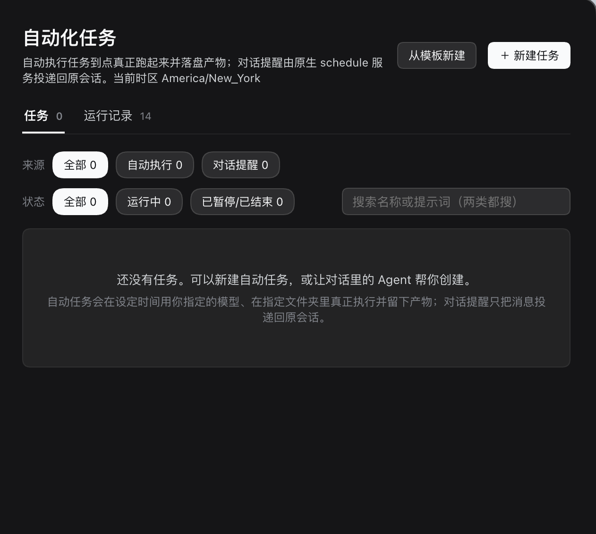
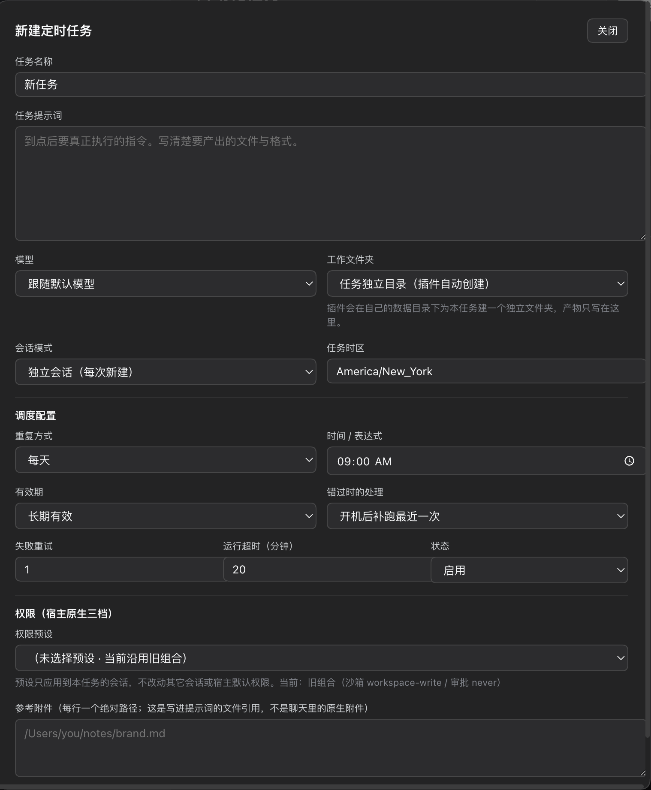

# DSH Task Center

[](https://github.com/pallwalt/dsh-task-center/actions/workflows/ci.yml)
[](LICENSE)

**Scheduled Agent execution, run history, and file artifacts inside DeepSeek Harness.**

[中文](README.md) · [Releases](https://github.com/pallwalt/dsh-task-center/releases) · [Usage](docs/USAGE.md) · [Compatibility](docs/COMPATIBILITY.md)

An independent community plugin for **DeepSeek Harness 0.2.1-rc.5**. Version
**0.1.0-beta.2** is the current public beta. The UI currently uses Simplified Chinese.



These are screenshots of the maintainer's real macOS installation, supplied on
2026-10-31. The empty task list and “14 run records” reflect that installation;
they are not bundled sample data or a test-coverage claim.

## Features

- One-off, interval, daily, weekly, and five-field cron schedules with per-task
  IANA time zones and latest-occurrence catch-up.
- Per-task model/reasoning selection, host workspace binding, permission presets,
  and independent or persistent sessions.
- Durable run history with outcome, timing, errors, tool activity, session links,
  and discovered file artifacts.
- Nine chat tools for task/run management, sharing the same engine as the UI.
- One native Automation entry containing both executable tasks and DSH's native
  conversation reminders. A delivered reminder records message delivery; an
  executable task records the Agent turn's outcome. Their stores stay separate.

## Install

Use an initialized DSH Desktop **0.2.1-rc.5** installation and its matching `dsh`
command. Launch Desktop once to initialize it, then **fully quit the app** before
installing. See the [official Desktop command guide](https://github.com/deepseek-ai/deepseek-harness/blob/master/apps/desktop/README.md#terminal-command)
if `dsh` is unavailable in your terminal.

Download `dsh-external-dsh-task-center-0.1.0-beta.2.tgz` from
[Releases](https://github.com/pallwalt/dsh-task-center/releases), then run from its
download directory:

```sh
dsh --version
# Expected: 0.2.1-rc.5
dsh plugin --profile desktop add ./dsh-external-dsh-task-center-0.1.0-beta.2.tgz
```

Reopen Desktop and select the existing Automation page. `SHA256SUMS.txt` is
provided with the release. A pinned GitHub install is also available; `lib/` is
committed, so installation does not need a build script:

```sh
dsh plugin --profile desktop add 'github:pallwalt/dsh-task-center#v0.1.0-beta.2'
```

Other DSH versions have not been accepted. Do not bypass the host compatibility
check. Distribution is through GitHub; the package is not published to npm.

## Create a task

Use “新建任务” (New task) or “从模板新建” (From template). Select a model,
workspace, permission preset, time zone and schedule. Specify a concrete output,
such as `summary.md`. Save paused first, review the settings, then enable or run
once. Running a task uses your own configured model provider and can incur costs.

<details>
<summary>Installed task editor</summary>



</details>

The Agent can also use `task_create`, `task_list`, `task_get`, `task_update`,
`task_enabled`, `task_run`, `task_delete`, `run_list`, and `run_cancel`.
DSH's native `schedule_create` creates a conversation reminder.

## Beta boundaries

- DSH must remain running. Shutdown/sleep interrupts scheduling; recovery follows
  the task's missed-occurrence policy.
- A working directory is organizational; enforcement belongs to DSH permissions.
- Cancellation is best effort. Providers and detached commands may continue
  after the run record is finalized.
- The deadline is checked after preparation, on session events and on scheduler
  recovery. The beta.1 warning cited runs that were actually interrupted or
  manually cancelled before their deadlines. See the corrected
  [timeout investigation](docs/TIMEOUT-INVESTIGATION.md) and its verification scope.
- Artifact discovery is bounded and based on file modification time. A successful
  turn does not guarantee a correct or complete output.
- Actual installation screenshots are from macOS. See
  [compatibility and known limitations](docs/COMPATIBILITY.md).

## Develop

Use Node.js **22+** and pnpm **9.15.9**:

```sh
git clone https://github.com/pallwalt/dsh-task-center.git
cd dsh-task-center
corepack enable
pnpm install --frozen-lockfile
pnpm gate
pnpm check:package
```

Run `pnpm verify:timeout --minutes=20` for an opt-in real 20-minute check of the
actual engine with instrumented, nonresponsive host seams and no real provider
calls. It covers hanging preparation, prompt and cancellation; it does not
replace prolonged live-provider acceptance.

`gate` runs type checking, engine/API regressions, the production build and a
client loader/component smoke test. It uses mocked host services and no model
calls. Package checks inspect and load the extracted installable artifact. CI
runs on Linux (Node 22/24) and macOS (Node 22), checks generated files against
source, and audits dependencies. These checks do not replace actual DSH UI or
provider acceptance.

Read [CONTRIBUTING.md](CONTRIBUTING.md), [architecture](docs/ARCHITECTURE.md),
and [SECURITY.md](SECURITY.md). Report ordinary problems in
[Issues](https://github.com/pallwalt/dsh-task-center/issues), with private data
removed. Report vulnerabilities privately.

Licensed under [BSD-3-Clause](LICENSE), matching the existing package declaration.
See [third-party notices](THIRD_PARTY_NOTICES.md). This is not an official
DeepSeek product.
