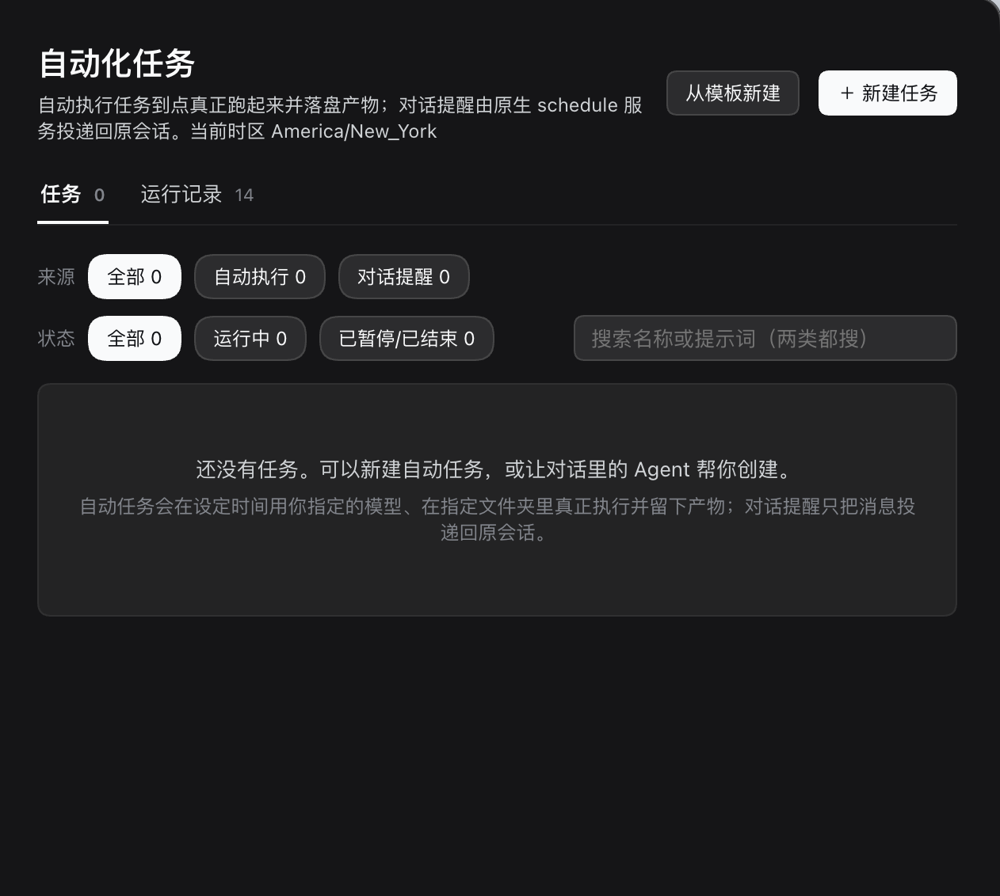
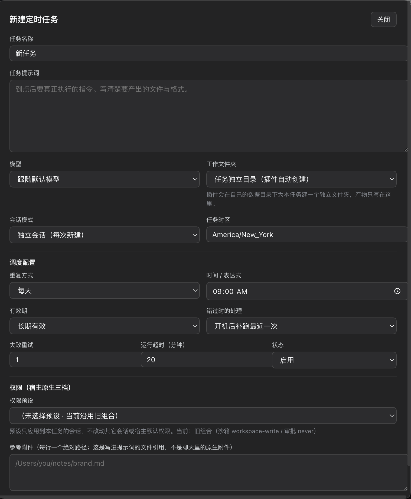

# DSH Task Center · 自动化任务中心

[](https://github.com/Platato-DA/dsh-task-center/actions/workflows/ci.yml)
[](LICENSE)
[](docs/COMPATIBILITY.md)
[](https://github.com/Platato-DA/dsh-task-center/releases)

**在 DeepSeek Harness 里定时执行 Agent 任务，留下运行记录和真实文件产物。**

[English](README.en.md) · [安装与使用](docs/USAGE.md) · [兼容性与限制](docs/COMPATIBILITY.md) · [发布检查](docs/RELEASE-READINESS.md) · [Release 下载](https://github.com/Platato-DA/dsh-task-center/releases)

这是独立的社区插件，适配 **DeepSeek Harness 0.2.1-rc.5**。当前版本为 **0.1.0-beta.2**，欢迎试用和反馈；目前的界面语言是简体中文。



上图与下方表单图均来自维护者实际安装后的 DSH，由维护者于 2026-10-31 提供。首页是空任务状态；截图中的“14 条运行记录”是该安装环境的历史计数，不代表公开测试覆盖或新安装自带的数据。

## 可以做什么

- **按计划执行**：单次、固定间隔、每天、每周和五字段 Cron；每个任务保存独立的 IANA 时区，支持错过后补跑最近一次。
- **按任务配置**：指定模型与思考强度、绑定宿主工作区或使用独立目录、选择原生权限预设。
- **保存执行结果**：查看成功、失败、等待审批、取消和超时状态，以及耗时、工具、错误、执行会话和文件产物。
- **选择会话模式**：每次新建独立会话，或持续使用该任务的专属会话；跨次数据可以保存在任务自己的数据目录。
- **在对话中管理**：通过 `task_create`、`task_list` 等九个工具创建和管理任务，与界面共用校验与存储。
- **复用原有入口**：接入原生“自动化任务”页面，同屏显示自动执行任务与原生对话提醒。提醒继续由 DSH 投递，两类数据分别保存。

| 类型 | 到点后的行为 | 记录含义 |
| --- | --- | --- |
| 自动执行任务 | 创建或复用会话，调用模型，在工作目录执行任务 | Agent 轮次的实际结束状态和扫描到的文件 |
| 原生对话提醒 | 由宿主把一条消息投递回原会话 | 消息投递结果；不表示任务已经执行 |

## 安装

需要已经初始化的 DSH Desktop **0.2.1-rc.5**，以及该版本配套的 `dsh` 终端命令。先启动 Desktop 一次完成初始化，安装前**完全退出应用**。终端命令的设置见 [DSH 官方 Desktop 文档](https://github.com/deepseek-ai/deepseek-harness/blob/master/apps/desktop/README.md#terminal-command)。

从 [Releases](https://github.com/Platato-DA/dsh-task-center/releases) 下载 `dsh-external-dsh-task-center-0.1.0-beta.2.tgz`，在下载目录执行：

```sh
dsh --version
# 预期：0.2.1-rc.5
dsh plugin --profile desktop add ./dsh-external-dsh-task-center-0.1.0-beta.2.tgz
```

重新打开 Desktop，进入左侧原有的“自动化任务”。Release 附带 `SHA256SUMS.txt`，可用于核对下载文件。

也可以安装固定的 GitHub 标签（仓库已包含 `lib/`，无需安装时编译）：

```sh
dsh plugin --profile desktop add 'github:Platato-DA/dsh-task-center#v0.1.0-beta.2'
```

安装与升级会经过 DSH 自身的版本检查。其他 DSH 版本目前不在支持范围；不要通过修改版本约束来绕过检查。更多方式、故障排查、升级和卸载见 [使用指南](docs/USAGE.md)。本项目目前通过 GitHub 分发，尚未发布到 npm。

## 第一个任务

1. 点击“新建任务”或“从模板新建”。
2. 选择模型和工作文件夹，写清提示词与预期产物，例如“读取本目录的 Markdown，生成一份 `summary.md`”。
3. 选择权限和任务时区，设定执行时间。建议先保存为暂停状态，检查配置后再启用。
4. 可用“立即运行”验证一次；调用模型会按你自己的 provider 配置计费。
5. 在“运行记录”查看执行会话、状态、错误和产物。

<details>
<summary>查看实际安装后的新建任务表单</summary>



表单较长，截图显示的是其主要配置区域。

</details>

对话创建示例：

> 帮我创建一个每天 09:00 的自动执行任务，时区 Asia/Shanghai，整理工作目录里的 Markdown，生成 summary.md。先保存为暂停状态，权限选择 workspace-write。

创建任务会安排将来的模型调用。请明确告诉 Agent 使用 `task_create`；宿主自带的 `schedule_create` 创建的是原生对话提醒。

## 使用边界

- **DSH 运行时才调度**。退出或休眠期间无法准点执行，恢复后按补跑策略处理。
- 模型和权限作用于任务会话；独立目录有助于整理文件，实际访问能力由 DSH 的权限机制决定。
- 取消和超时会记录结果并请求宿主停止，外部 provider 或已启动的命令可能仍需人工检查。
- 超时会在准备返回、会话事件及调度恢复时再次核对截止时间。旧文档所指的运行实际在截止前被重载中断或手动取消，已更正；调查、修复与验证范围见 [超时调查](docs/TIMEOUT-INVESTIGATION.md)。
- 文件产物由目录扫描推断，不等于模型输出质量已获验证。扫描有深度和数量上限。
- 首版的实际安装截图来自 macOS；其他系统的真实 DSH 安装体验仍需反馈。详见 [完整限制](docs/COMPATIBILITY.md)。

## 开发与验证

开发环境：Node.js **22+**、pnpm **9.15.9**。

```sh
git clone https://github.com/Platato-DA/dsh-task-center.git
cd dsh-task-center
corepack enable
pnpm install --frozen-lockfile
pnpm gate
pnpm check:package
```

完整实际计时验证可运行 `pnpm verify:timeout --minutes=20`，需等待约 20 分钟，使用真实执行引擎与受控宿主接口，不调用付费模型。它覆盖准备不返回、模型请求不返回和取消不返回；不能替代真实 provider 的长期验收。

`gate` 包含严格类型检查、引擎/API 回归、构建与客户端加载/组件冒烟检查；本地检查使用模拟宿主，不会运行真实模型。`check:package` 会检查最终安装包的文件清单并从解包后的产物加载宿主入口。CI 在 Linux（Node 22/24）和 macOS（Node 22）执行这些检查，另查预构建文件是否与源码一致及依赖漏洞。

仓库保留预构建的 `lib/`，方便从 GitHub 标签安装；修改源码后需重新构建并一起提交。欢迎阅读 [贡献指南](CONTRIBUTING.md) 和 [架构说明](docs/ARCHITECTURE.md)。

## 反馈与许可

普通问题和建议请提交 [Issues](https://github.com/Platato-DA/dsh-task-center/issues)。报告前移除密钥、个人目录、任务数据库和完整会话；安全漏洞请按 [安全政策](SECURITY.md) 私下反馈。

本项目沿用现有包声明的 **BSD-3-Clause** 许可证，正文见 [LICENSE](LICENSE)。第三方依赖与产品名称说明见 [THIRD_PARTY_NOTICES.md](THIRD_PARTY_NOTICES.md)。
