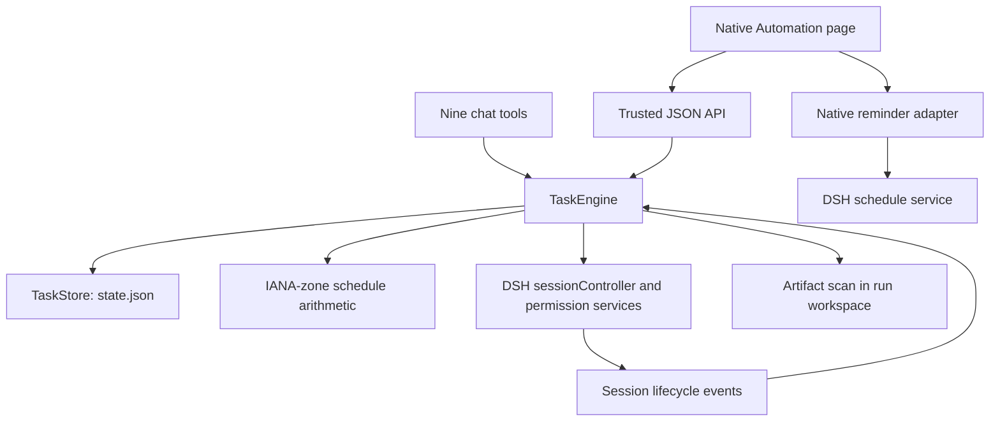

# Architecture

The host engine has no imported DSH runtime implementation. It uses the services
provided by its Cordis context and Node built-ins; the browser bundle uses the
host's shared React/module registry.

## Main modules

| Module | Responsibility |
| --- | --- |
| `src/index.ts` | Host lifecycle, defaults and single-generation teardown |
| `src/host/engine.ts` | Scheduling, queues, session preparation, lifecycle, recovery and retries |
| `src/host/time.ts` | Five-field cron, intervals, IANA time zones and DST |
| `src/host/store.ts` | Durable JSON, repair reporting and preservation of damaged input |
| `src/host/artifacts.ts` | Bounded modified-file discovery |
| `src/host/api.ts` | Trust checks, request policy, UI transport and artifact serving |
| `src/host/tools.ts` | Model-visible task/run management tools |
| `src/host/reminders.ts` | Native reminder read/update/delete adapter |
| `src/client/index.tsx` | Native-slot UI, forms, filters and run details |
| `src/shared/types.ts` | Shared records and API types |

## Separate records

A task definition, its next planned occurrence, a concrete run, and its delivered
files are separate concepts. Reminder delivery is a fifth, host-owned concept.
Run status follows DSH session events rather than the acceptance of a prompt.
Tasks are serialized individually, with bounded global concurrency.

One scheduler timer is re-armed at the nearest occurrence, capped at 30 seconds
between checks. Timeout starts before asynchronous session/model/permission
preparation. Pending retries use persisted deadlines. A fresh engine marks
unfinished old runs as interrupted rather than claiming they completed.

## Host seams

Required injection: `webServer`, `sessionController`, `tools`, `approval`.
Optional capabilities are read through `ctx.get(name, false)`, including
`connection`, workspace registry, model/default selection, permission presets,
and native scheduling. Missing trust fails closed. A selected model cannot fall
back to changing the host's global default when per-agent selection is absent.

The client registers the existing `main/schedules` key at priority `-10`, keeping
the native priority-0 page registered. It also redirects the old `task-center`
key. Unloading releases registrations; there is no extra sidebar entry.

## Build and distribution

`lib/index.js` is a stable host shim; `lib/impl.js` is bundled ESM;
`lib/client.js` is CJS inside the DSH `__ModuleLoader__.load` envelope. React is
external. Built files are versioned for GitHub installs and checked against
source by CI. The release tarball contains reviewed runtime/docs files and no
install-time build hook.

## Verification boundaries

Engine/API regressions use fake host services and temporary files. Client smoke
checks use a React stand-in and the actual loader envelope, including both slot
registration orders and unload restoration. Package checks import the unpacked
host entry. These prove local behavior at those seams; they do not prove a live
provider's output quality, desktop accessibility, or unattended long-run
reliability. See [COMPATIBILITY.md](COMPATIBILITY.md).
